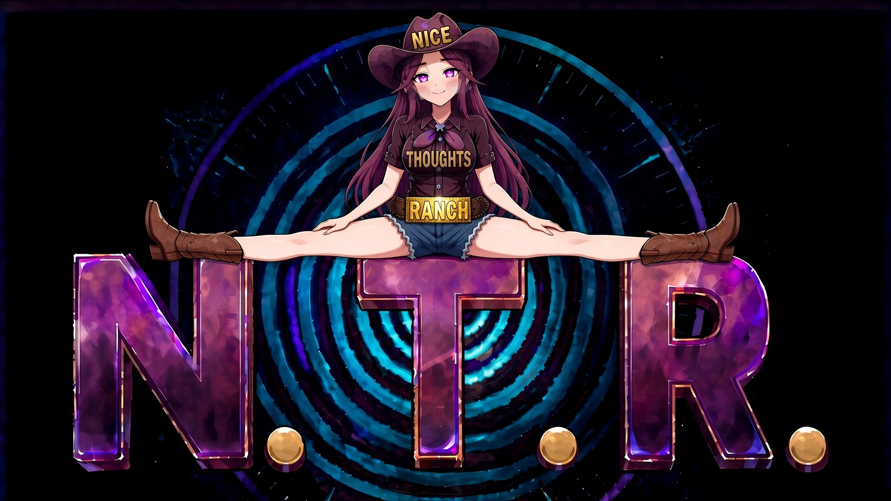

  

<h1 align="center">Nice Thoughts Ranch</h1>

<em>An independent game studio. Mind the spiral.</em>

  
  
  

## Welcome to the Ranch

Nice Thoughts Ranch is an indie game studio building story-driven games about desire, attention, and the choice to be seen. The cowgirl in the hat is **Nancy T. Rae**, our mascot and host — folks in the know just call her Neto-chan.

## Now in development — STROBE

**STROBE** is our first title: a character-driven game following ten heroines, each with a hidden hunger and a story told in stages — from unaware, to first spark, to choosing for herself. Agency isn't a theme we gesture at; it's the structure. Every arc turns on the moment she decides.

- Design bible (the cast book): [NTRanch/Strobe](https://github.com/NTRanch/Strobe)
- Storefront: [ntranch.itch.io](https://ntranch.itch.io)

*STROBE is an adults-only (18+) title.*

## Contact

- **itch.io:** [ntranch.itch.io](https://ntranch.itch.io) — our storefront, and the best way to reach the Ranch
- **Web:** [ntranch.io](https://ntranch.io)

Ranch rules: everyone depicted is an adult, and every story turns on a choice.

